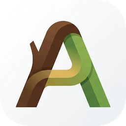
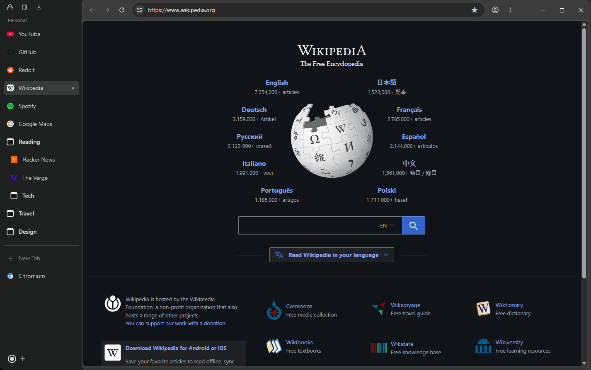
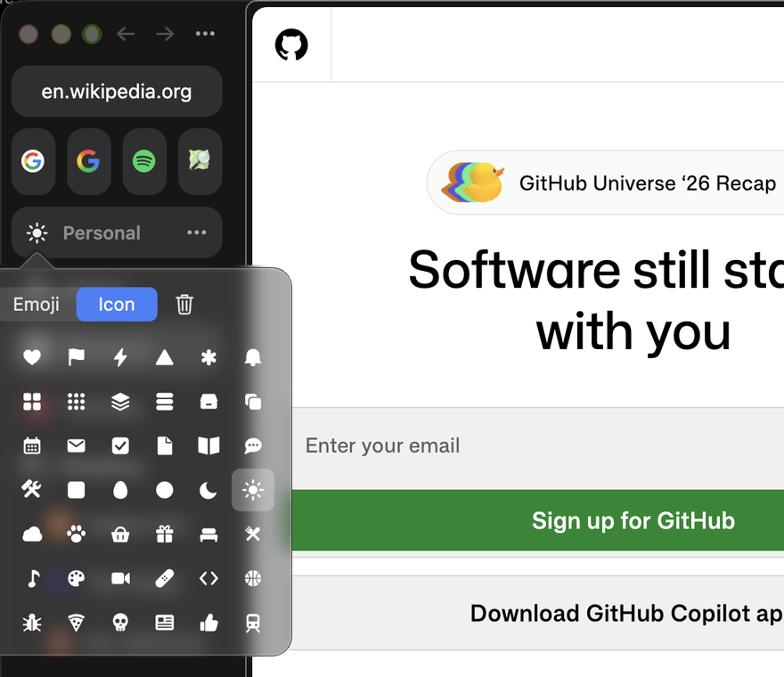
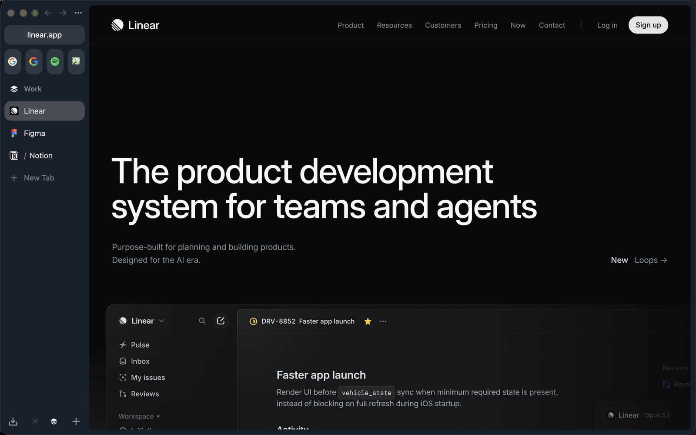
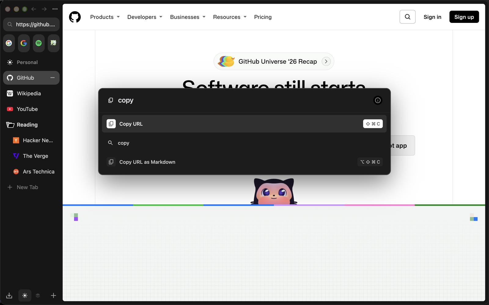
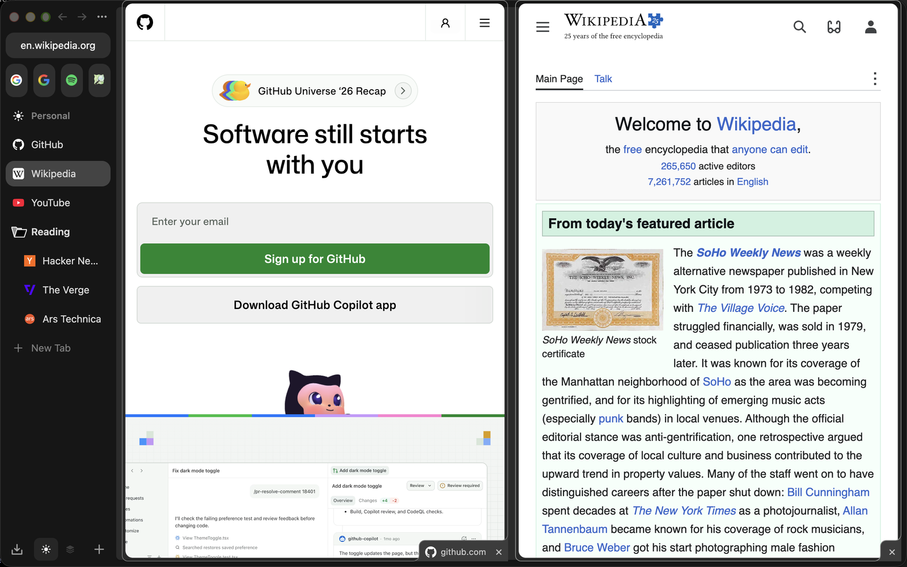

  

<h1 align="center">Alerse</h1>

A sidebar browser for people moving from Arc, built on ungoogled-chromium.

Alerse gives you a vertical sidebar, Spaces with separate logins in one window, a
command bar and sync you can host yourself. Its name is a free spelling of alerce, the
Chilean tree.

This repository holds what all platforms share: the Chromium patches, the design notes
and a fallback Arc import script. Builds come from the platform repositories.

## Install

| Platform | Download | First start |
|---|---|---|
| Windows 10 and 11 (x64, arm64) | installer or zip from [alerse-win releases](https://github.com/VizzleTF/alerse-win/releases) | SmartScreen warns about an unsigned app: More info, Run anyway |
| macOS (Apple Silicon) | `.dmg` from [alerse-mac releases](https://github.com/VizzleTF/alerse-mac/releases) | drag Alerse to Applications, then run `xattr -dr com.apple.quarantine /Applications/Alerse.app` |
| Linux (x86_64, arm64) | AppImage or tarball from [alerse-linux releases](https://github.com/VizzleTF/alerse-linux/releases) | `chmod +x` the AppImage |
| iPhone | build from source: [alerse-ios](https://github.com/VizzleTF/alerse-ios) | |

Alerse tells you about a newer release in the logo menu (on macOS the app menu); you
install it yourself.

## Features

- **The sidebar**: Space name, pinned items in nested folders, open tabs under
  collapsed folders, a popup of a folder's links on hover, New Tab, then the Space's tabs.
  Arc's icon pickers give pinned items, folders and Spaces a glyph (Spaces also an
  emoji), and the Space menu collapses or expands all folders at once.

  

 
  As in Arc, a hovered pinned item's "−" closes its tab and keeps the item, and with no
  tab open its "×" removes the item.
- **Spaces in one window**: each Space keeps its own cookies and site data, so you can be
  logged into different accounts side by side. Spaces survive restarts.

  
- **Sync on your terms**: bookmarks, tabs, passwords and settings through your own
  [alerse-sync](https://github.com/VizzleTF/alerse-sync) server, end-to-end
  encrypted, with no account: devices join with a 24-word sync code. Set it up from **Sync**
  in the app menu. A free public server is planned.
- **Command bar actions**: type a command's name in the command bar to run it, as in
  Arc: Copy URL, Copy URL as Markdown or as Quote, Pin or Unpin Tab, New Space, Rename
  Space, Edit Theme, New Folder, Collapse Pinned Tabs, Reveal Tab in Sidebar, View
  History, Settings and more, each with its shortcut.

  

  Arc's keys too: Ctrl+Shift+C (Shift+Cmd+C) copies the address,
  Ctrl+Shift+Alt+C (Option+Shift+Cmd+C) copies it as a Markdown link, Ctrl+D (Cmd+D)
  pins or unpins the tab.
- **Split View**: two pages side by side, as in Arc. Ctrl+Shift+= (Control+Shift+= on
  a Mac) adds a pane and opens the command bar to fill it; Ctrl+Shift+- closes the
  shown pane, Ctrl+Shift+1 and 2 switch panes. Drag a tab onto another tab in the
  sidebar, or onto the page's edge, to split the two; the sidebar shows a split as
  one row, and dragging a pane out of it separates it. Also Open in Split View in the
  sidebar's menus and the split items of the View menu (macOS) or the logo menu.

  
- **Arc's menu bar on macOS**: File, Edit, View, Spaces, Tabs, Archive, Extensions,
  Window and Help with Arc's items and keys: the Spaces menu lists your Spaces
  (Control+1 to 9), the Extensions menu your extensions, Cmd+1 to 9 open the sidebar's
  items, Copy URL as Quote copies a selection with its link. The sidebar's menus have
  Arc's Share (AirDrop, Mail, Messages...) and a folder's Share Folder....
- **Link routing**: links from other apps open in the Space you choose for their site,
  such as github.com in Work.
- **Media**: a mini player at the bottom of the sidebar for media playing in another
  tab, and picture-in-picture when you leave a playing video.
- **Import from Arc and other browsers**: Arc's Spaces, pinned tabs, nested folders and
  icons, and the bookmarks of Chrome, Edge, Brave, Vivaldi, Opera, Yandex Browser and
  Chromium, built in.

## Differences from Arc

- **No account and no AI.** Nothing signs in to a company, and there is no assistant,
  summaries or AI search.
- **ungoogled-chromium underneath**, with its privacy defaults (see [Privacy](#privacy)).
- **Sync of its own**, end-to-end encrypted on a server you run
  ([alerse-sync](https://github.com/VizzleTF/alerse-sync)): devices join with a 24-word
  sync code, or with a login and password and a short pairing code; a recovery sheet
  keeps the code safe.
- **Windows looks like Arc for macOS** everywhere except the top bar, which stays Arc
  for Windows': the sidebar, Space bar, popovers, folder popup, page card, hidden
  sidebar and command bar are the Mac's.
- **Downloads instead of the Library** at the left of the Space bar.
- **Not built**: Easels, Boosts, Little Arc, Peek and the tab archive.

## Move from Arc

Open the Alerse menu (the logo at the top of the sidebar; on macOS the app menu) and
pick **Import from Another Browser...**, or go to `chrome://alerse-import`. The page
lists what it finds on this computer, with an **Import** button for each:

- **Arc** (Windows and macOS): every Space with its pinned tabs, nested folders, folder
  icons and cached favicons. The first Space goes to Home; each of the others becomes a
  Space in the Space bar.
- **Chrome, Edge, Brave, Vivaldi, Opera, Yandex Browser, Chromium** (Windows, macOS,
  Linux), each profile on its own: the bookmarks go to a folder named after the browser
  (and the profile, when there are several), pinned in the current Space.

Alerse only reads the other browsers' files, so they can stay open. Importing a source
again replaces what it brought in before. For Firefox, Safari or an HTML bookmarks file,
the page links to the standard importer.

Fallback, for a profile Alerse is not running on: close Alerse and run
`python tools\arc_import.py --profile "%LOCALAPPDATA%\Alerse\User Data\Default"`
(Python 3, Windows; without `--profile` it writes to Chromium's profile directory). It writes the same Arc bookmarks
straight into the profile's `Bookmarks` file, replacing what it or the import page
imported before; each new Space you then create with "+" takes the next imported Arc
Space.

## Repositories

| Repository | Contents |
|---|---|
| alerse (this one) | Patches, design notes, icon artwork, fallback Arc import script |
| [alerse-win](https://github.com/VizzleTF/alerse-win) | Windows build and releases |
| [alerse-sync](https://github.com/VizzleTF/alerse-sync) | Sync server |
| [alerse-mac](https://github.com/VizzleTF/alerse-mac) | macOS build on ungoogled-chromium-macos |
| [alerse-linux](https://github.com/VizzleTF/alerse-linux) | Linux build on ungoogled-chromium-portablelinux |
| [alerse-ios](https://github.com/VizzleTF/alerse-ios) | iOS build on Chromium iOS (`patches/series-ios`): sync and branding |

## Status

| Area | State |
|---|---|
| Spaces with separate logins | done; recently closed tabs reopen without their Space's logins |
| Sidebar, drag and drop, command bar | done |
| Import from Arc and Chromium-based browsers | done; Windows only (0.1.3+) until Linux and macOS move to 157 |
| Sync | done with your own server: Windows, Linux, macOS and iOS in one chain; only Windows 0.1.2+ holds data back until it is end-to-end encrypted, so start a chain there; public server to do |
| Windows | releases on Chromium 157 |
| Linux | releases on Chromium 156, built in CI |
| macOS | on Chromium 156, built locally without PGO, until ungoogled-chromium-macos ships 157; Arc's menu bar instead of the top bar and logo menu |
| iPhone | builds and syncs in the simulator; Spaces and the sidebar not on iOS |
| Link routing to Spaces | done: routes by site at Link routing in the app menu |
| Media mini player, auto picture-in-picture | done |
| Updates | the browser tells about a newer release; you install it yourself |
| Code signing | none yet: Windows SmartScreen warns, macOS needs the quarantine flag removed |

## Privacy

Alerse keeps ungoogled-chromium's privacy defaults, with these exceptions:

| Exception | What reaches Google | Off by |
|---|---|---|
| Google is the default search engine | Your searches, only when you search | Picking another engine in the menu of the sidebar's logo, Search Engine |
| Search suggestions can be turned on | What you type in the address bar | They are off unless you turn them on in settings |
| The Chrome Web Store installs and updates extensions | Installed extensions' IDs and versions, in update checks | Not installing extensions from the Web Store |

Alerse has no updater. A few minutes after it starts, and then once a day, it
asks GitHub's API for the platform's latest release: a plain GET of
`api.github.com/repos/VizzleTF/alerse-<platform>/releases/latest`, without
cookies. When the release is newer, the menu of the sidebar's logo (on macOS, the
app menu) shows "Update to Alerse X.Y.Z", which opens the release's page; nothing
is downloaded by itself. To turn the check off, quit Alerse and set
`"arcomium": {"update_check": {"enabled": false}}` in the `Local State` file of
Alerse's user data folder (`%LOCALAPPDATA%\Alerse\User Data` on Windows).
Headless mode and `--disable-background-networking` turn it off too.

Besides these, the sync server you set up and the Web Store, Alerse makes no network
requests of its own.

What the same defaults leave out, so that you can decide knowingly:

- **No Safe Browsing.** Alerse does not check pages or downloads against Google's
  lists of phishing and malware, and it saves downloads without asking. Be as careful
  with a download as you would be without a browser's warning.
- **No background security data.** Chrome fetches certificate revocation lists and
  the list of Certificate Transparency logs between releases; Alerse has no component
  updater, so these are as old as the build. Chromium stops enforcing Certificate
  Transparency about ten weeks after a build was made.
- **Security fixes arrive with releases only.** Alerse follows ungoogled-chromium,
  which follows Chrome's stable channel by some days, and does not update itself. Keep
  to the latest release; a build more than a few weeks old is missing fixes.

ungoogled-chromium rewrites Google domains in the source after the patches apply. The
Web Store's addresses in `extensions/web-store.patch` are written split
(`"clients2.goo" "gle.com"`) so that this rewriting leaves them working.

## Learn more

- [How Alerse works](docs/design.md): Spaces, the sidebar, sync, platforms.
- [Writing and refreshing patches](docs/patching.md).
- [Versions and releases](docs/versioning.md).

## License

BSD-3-Clause, as Chromium and ungoogled-chromium.

Alerse is an independent project. It is not affiliated with, endorsed by or sponsored by
The Browser Company. Arc is a trademark of its owner and is named here only to say what
Alerse imports from and who it is meant for; Alerse uses none of Arc's code, artwork
or branding. The icon (`artwork/`) is Alerse's own.
